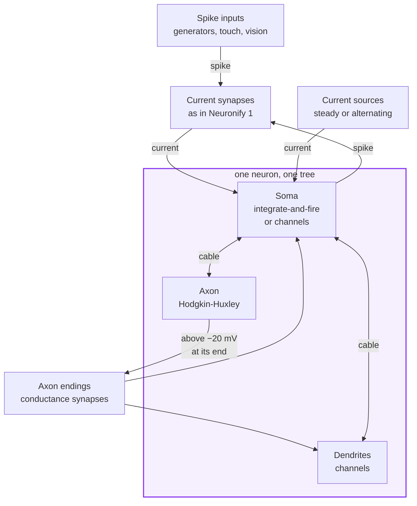
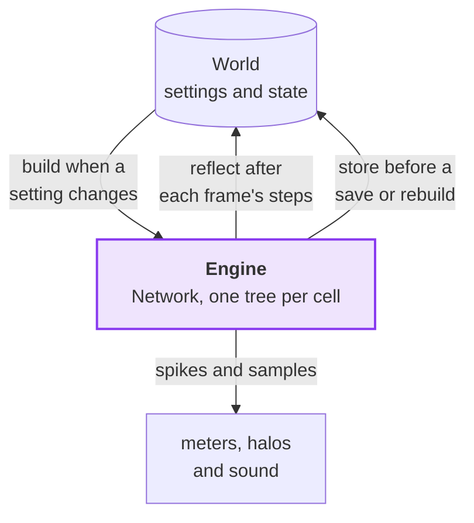
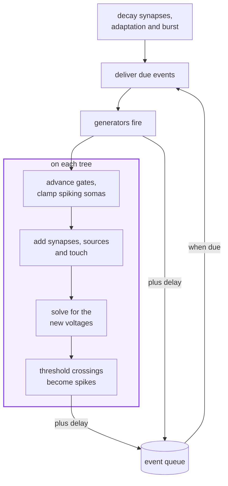
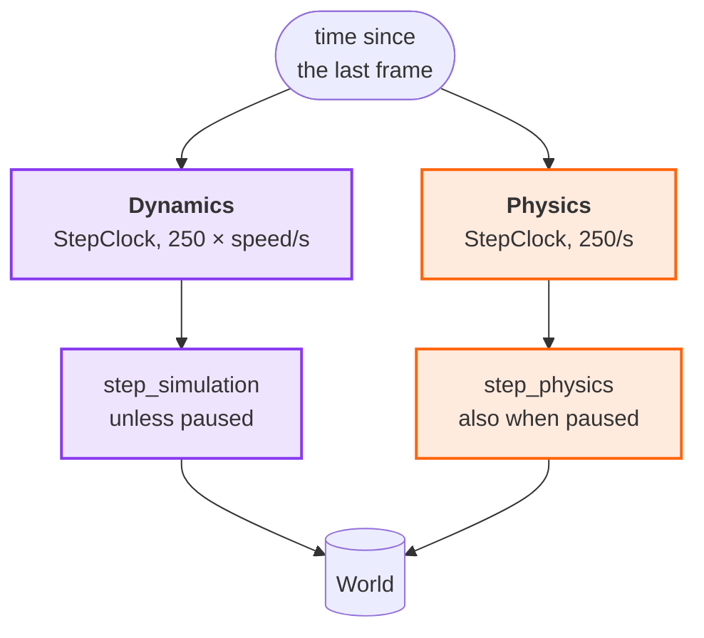
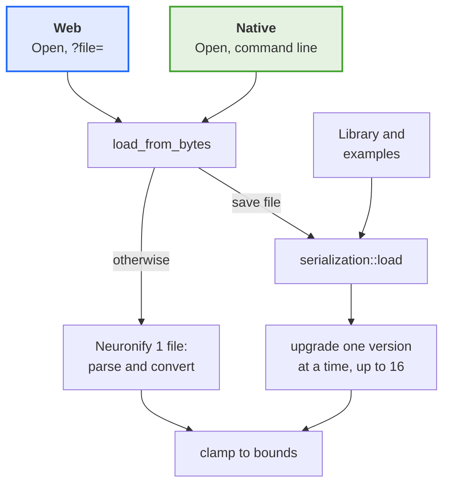
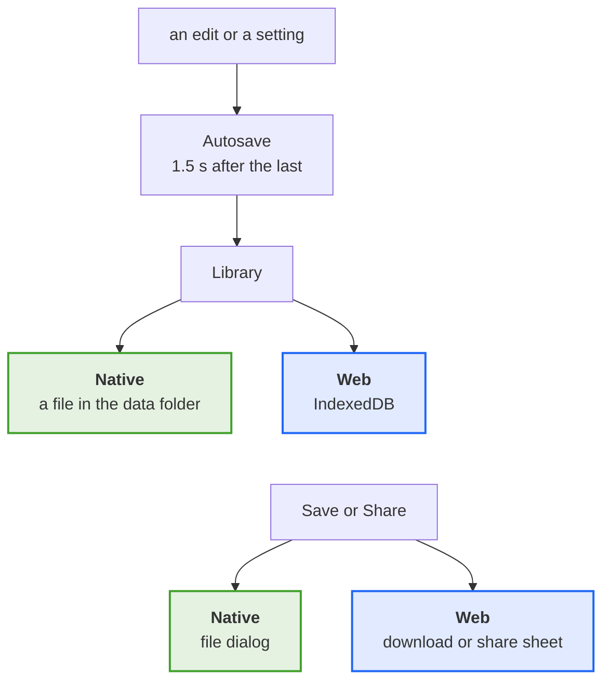
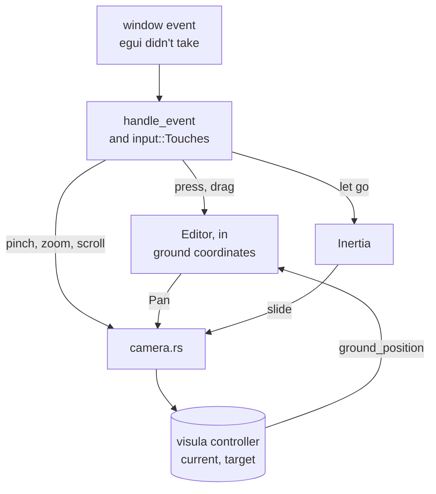
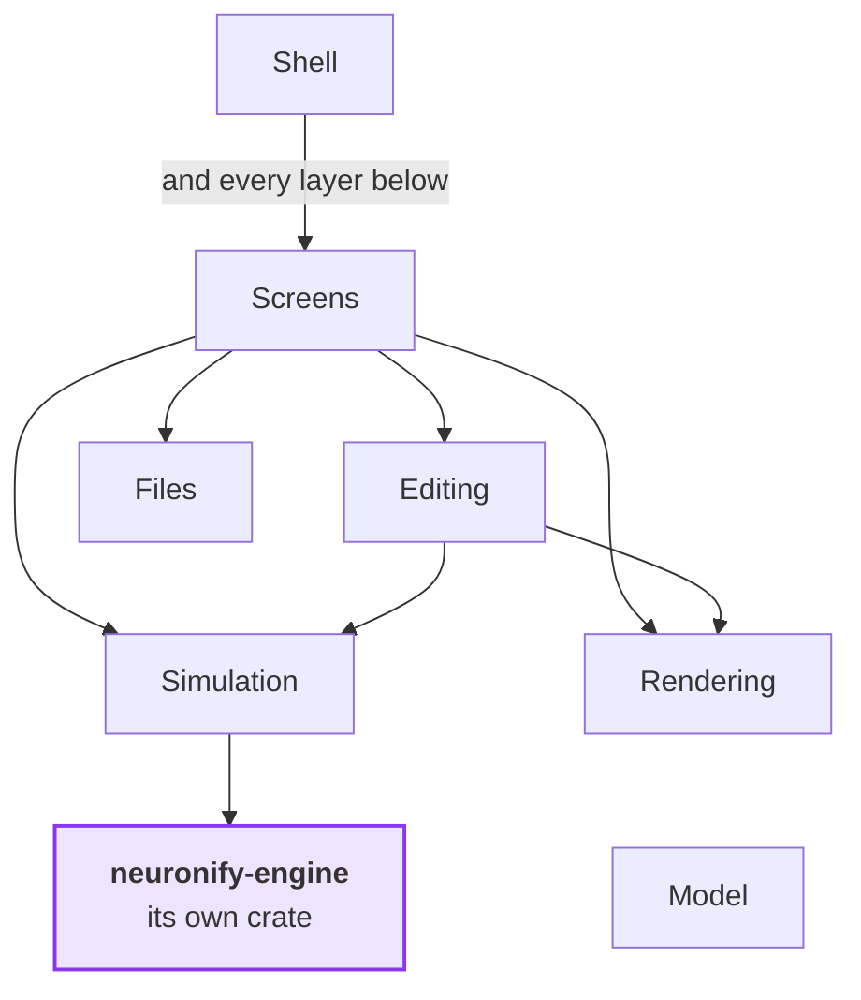

# Neuronify architecture as it is

How Neuronify 2 works today, for people and agents who want to change it.
`future.md` collects changes under consideration.
In the diagrams, purple marks the neuron dynamics, orange the physics,
green what runs only natively and blue what runs only on the web.

## Which models run

Every neuron is a tree of electrical points:
a soma, and the compartments of its dendrites and axon, joined by cables.
`neuronify-engine` simulates these trees and the synapses between them
in mV, ms, nA, µS and µm, with a type for each unit (`units.rs`):



Each point follows the cable equation with the channels of its membrane:

```text
point:    C dV/dt = g_L (E_L - V) + Σ g_max m^p h^q (E - V)
                    + Σ g_axial (V_next - V) + I_inject + g_syn (E_syn - V)
gate:     x ← x∞ + (x - x∞) e^(-dt/τx), with x∞ and τx looked up by V
soma:     past threshold, clamped to a 1 ms spike up to +30 mV,
          then held at reset until the refractory period ends,
          unless it is a compartment soma, which spikes through its channels
synapse:  g ← g e^(-dt/τ), and g += w a delay after each spike
```

### Preparations and cables

The menu picks the channels (`Preparation`) and the `Temperature` per simulation:

| | Squid | Mammal |
| --- | --- | --- |
| Default temperature | 16.3 °C | 37 °C |
| Axons | 0.15 µm, Hodgkin-Huxley squid channels | 0.4 µm, cortical sodium and potassium channels |
| Dendrites | the squid channels, about half as fast | cortical sodium and potassium, A-type potassium and HCN channels |
| Compartment somas | cortical sodium and potassium | cortical sodium and potassium |

Myelinated axons alternate nearly leak-free internodes of 280 µm
with 1 µm nodes of Ranvier, and other cables are 100 µm long.
The d_lambda rule splits every cable into an odd number of segments
(0.3 of the length constant at 100 Hz).
Dendrites taper with their distance from the nearest soma when they are drawn.
A soma comes in two kinds, fixed when the neuron is made.
A point neuron's soma is a point with the neuron's capacitance and leak (0.2 nF and 100 MΩ),
or a passive sphere 20 µm across if dendrites are drawn onto it.
A compartmental neuron's soma (`CompartmentSoma`, added by `spawn_dendrites`)
is a sphere 20 µm across with 0.4 S/cm² sodium and 0.5 S/cm² potassium channels,
balanced to rest at the neuron's resting potential.
From a current source it fires from about 0.75 nA and goes silent above about 4 nA in mammals,
and from 0.5 nA to about 6.5 nA, more slowly, in squid.
It is drawn blending into each dendrite and axon through a smooth fillet,
wider at the base of longer branches, while a point neuron's soma stays a plain sphere.

### Rules and defaults

Most of these defaults can be changed in the inspector:

- Point neuron soma: threshold −55 mV, reset −80 mV, refractory period 2 ms, clamp 1000 µS.
- Compartment soma: a spike counts when the voltage climbs past −20 mV,
  and the next one only after it has fallen back below.
- Axon start: its first compartment above −20 mV fires a point neuron's soma.
- Axon ending: opens 0.5 ms after the axon's last compartment passes −20 mV,
  with 0.0055 µS times its strength (0 to 2), times 8 on a soma,
  or on a dendrite times the size of the cables there (about twice that for mammals),
  and 40 times more if inhibitory.
  It decays with 2 ms towards 0 mV, or 6 ms towards −70 mV if inhibitory.
- Static connection: a current synapse of 6 nA after 5 ms,
  decaying with 2 ms or as an alpha function, negative from an inhibitory source.
  From a touch sensor, it fires its neurons at once (`ImmediateFireSynapse`).
- Current source: 2 nA, or a sine of 0.3 nA at 50 Hz.
- Generators: regular ones fire at the exact moment within a step,
  and Poisson ones use a seeded generator whose state is saved.
  A visual input is Poisson, at a rate set by how well a moving picture
  matches its receptive field.
- Adaptation: 0.01 µS towards rest per spike, decaying with 500 ms.
- Burst: a 1.2 nA boost after a spike, draining linearly.
- Touch: a press fires what is under it once (`fire_nearby`).
  Holding injects 0.3 nA into a point neuron's soma, or 0.25 ms pulses
  into a compartment or a compartment soma
  at about the rate a default integrate-and-fire neuron would fire.

### Where the models break with modelling principles

These choices improve the experience and flow of the app,
and the aim is still to make the models more realistic:

- Point neuron soma: spikes by a rule, a scripted shape held by a strong clamp,
  rather than through channels.
- Compartment soma: its sodium density is closer to an axon initial segment than a soma,
  since there is no initial segment and a soma with soma-like densities doesn't fire.
  The squid preparation gives it cortical channels too,
  because squid channels on a soma this small don't fire repeatedly.
- Axon start and endings: rules of thumb (−20 mV, a fixed delay),
  with ending scales picked rather than derived.
- Static connections and touch sensors: inject a current or fire directly,
  as in Neuronify 1, rather than opening a conductance.
- Touch pulses on a compartment: timed by an integrate-and-fire formula.
- Drawing: cables look thicker than they are unless true proportions are on.

## How the dynamics are integrated

The `World` holds every setting and piece of state,
and `simulation::Engine` builds a `neuronify_engine::Network` from it:
one `Tree` per cell, plus the synapses, sources, generators and voltmeter probes.



Before each frame's steps, `Engine::sync` compares a fingerprint of the settings.
When it changes, `sync` stores the state, rebuilds and restores,
so an edit keeps voltages and pending spikes.
Positions aren't in the fingerprint, so dragging doesn't rebuild.
A loop of cables loses one cable,
and a cell that can't be built is left out with a log line.
`reflect` writes back what rendering needs (voltages, gates, time since a spike),
and `store` the rest (pending events, synapse state, the random state).

### A step

Each frame, `step_simulation` syncs, applies the touch, sets the visual input rates
and runs a number of 0.025 ms steps, each like this:



- Voltages: backward Euler, solved per tree in linear time (Hines' method),
  so fine segments stay stable.
- Gates: exponential Euler with the voltage from the start of the step,
  from tables in 0.1 mV steps that are rebuilt when the temperature changes.
- Synapses: exact decay factors.
- Spikes: timed within the step, then queued until their delay has passed.

Spikes leave the engine as `Spike` events for the firing-rate halos (τ = 50 ms),
spike detectors, rate plots and loudspeakers.
Voltmeters read probes that sample every fourth step.

## How the spatial physics relates to the dynamics

The physics and the dynamics share only the `World` and run on their own clocks,
each turning the time since the last frame (at most 0.1 s) into whole steps:



At speed 1, a second on screen is 6.25 ms of simulated time, as in Neuronify 1
(the speed goes from 0.5 to 8, and is 2 by default).
The landing previews step their own worlds the same way.
Cables are both the electrical and the mechanical structure,
but a cable's electrical length is fixed when it is made,
so stretching it on screen doesn't change the model.
The physics never reads voltages,
and the dynamics read positions only to find what a touch reaches.

### Forces

Each physics step (`simulation::spatial`) adds up these forces:

- Repulsion: between elements closer than two radii, found through a grid,
  except that axons don't push dendrites.
- Bending: along dendrites, straightens each pair of consecutive cables.
- Smoothing: along axons, evens each bend out towards its neighbours.
- Springs: pull each cable towards its length (two radii per 100 µm),
  and each axon ending towards its target without pulling the target.
- Gravity: pulls back down to the plane y = 0.

`integrate_motion` then updates the velocity before the position (dt = 0.001 s),
damps the velocity and keeps everything above y = 0.
Only compartments have `SpatialDynamics`, so somas and other elements push but don't move.
Compartments being drawn are held still,
and dragging a neuron moves its compartments directly (`editor/drag.rs`).

## How files are saved and loaded

### Loading

`load_from_bytes` tells save files (`.neuronify`)
from Neuronify 1 files (`.nfy`) by their first bytes:



On the web, `update` opens a file once the browser has loaded it.
Everything opened ends in `Neuronify::open_world` with a new `Engine`.
`bounds::bound` clamps every value to the newest version's ranges,
so a broken file loads safely.
The bundled examples are save files written by the programs in `neuronify-core/generators`.
A landing card opens its file again, so nothing carries over from its preview.
A note's `Link` opens another example,
and a Neuronify 1 tutorial's next link opens the file beside it.

### Saving

Both ways go through `Engine::store` and `serialization::save(world, time, speed)`:



Edits (`take_edited`) start the autosave timer, and so do speed and view changes
(`take_settings_changed`) for a simulation that is already in the library.
`app` also saves pending edits before it opens another circuit or the landing screen,
and when the window is hidden or closed.
On the web, each edit also writes a backup to local storage,
which `Library::poll` saves into the library on the next start.
A file opened through the dialog joins the library at once,
and an example or `?file=` only once it is edited.
Failed reads and writes show in a window or the log instead of closing the app.

### The file format

A save file is a snapshot of the running simulation.
Besides the settings, it holds the voltages and gates of every point,
pending spikes and events, generator timers, the random state, velocities,
the selection, and what each meter shows (about 111 ms for a voltmeter).
It leaves out `FiringRate`, `Gliding` and what the loudspeakers have heard,
and `serialization/v16.rs` lists what it keeps:

| Bytes | Content |
| --- | --- |
| 9 | `neuronify` |
| 4 | version, `u32` LE |
| 8 | time, `f64` LE (from version 5, in milliseconds from version 15) |
| 8 | speed, `f64` LE (from version 6) |
| rest | the `World` in hecs' column format, through postcard |

postcard writes a component as its position in the version's `schema!` list,
so a list is fixed once files exist.
Changing the list, a component's fields or a range in `bounds`
takes a new module `vN` with an upgrade
(the steps are in the doc comment of `serialization/mod.rs`):

| Version | Change |
| --- | --- |
| 2 | Adds `NoteSize`. |
| 3 | Adds `Dendrite` and `BurstCurrent`. |
| 4 | Replaces the `Inhibitory` marker with `NeuronType::Inhibitory`. |
| 5 | Stores the simulation time. |
| 6 | Stores the simulation speed. |
| 7 | Adds `Link`. |
| 8 | Adds `NeuronDisplay`. |
| 9 | Adds labels, meter ranges, the alternating current, spike detector, firing rate plot, loudspeaker and visual input, and moves a voltmeter's trace onto a wire per neuron. |
| 10 | Adds `Myelin`. |
| 11 | Lets a visual input's picture move at a set speed, stop, or be placed by hand. |
| 12 | Moves to the compartment engine: `NodeState`, `CableState`, `Cable`, `Membrane`, `ConductanceSynapse` and `SynapseState` replace `LeakyDynamics` and `CompartmentCurrent`, and `Temperature` and `Randomness` are added. |
| 13 | Adds `Preparation`. |
| 14 | Adds `ConnectionView`, `Selected` and `RowOrder`. |
| 15 | Gives every quantity a unit and counts time in milliseconds. |
| 16 | Adds `PendingEvents` and the soma diameter, clamps loaded values to `bounds`, and measures edge field angles like picture and orientation angles. |
| 17 | Adds `CompartmentSoma`, given on upgrade to neurons that have dendrites. |

## How the camera works

visula's `CameraController` eases a current transform towards a target
(a center on the ground, a fixed tilt of 6.7° from straight down, and a distance).
Neuronify turns off visula's own mouse handling and sets both from `camera.rs`,
and the editor works on the ground plane through `camera::ground_position`:



| Input | Function | Effect |
| --- | --- | --- |
| drag the background | `pan` | keeps the grabbed ground point under the pointer |
| pinch | `pinch` | zooms by the change in spread and follows the midpoint |
| let go of a pan or pinch | `slide` | glides on, see below |
| double tap and drag | `drag_zoom` | halves or doubles the distance per 150 points dragged |
| scroll | `scroll` | changes the distance by 10 % per line |
| open a circuit | `frame` | fits the circuit into the area the panels leave free, at a distance of 50 to 200 |

All but `scroll` set both transforms, so they act at once;
`scroll` sets only the target, so the zoom eases.
The distance stays between 5 and 200, and the view never rotates.
The editor returns a `Pan` for a drag that starts on the background with the Edit tool,
or anywhere in view mode except on a touch sensor.
The loupe doesn't move the camera; it magnifies the rendered frame around the finger.

`Inertia` (in `inertia.rs`) records where the pointer, or the midpoint of a pinch, was while it panned.
On letting go, it takes the average velocity over the last 50 ms, counting the moment of letting go,
so a finger that paused before lifting leaves the view still.
The glide then loses speed exponentially with a time constant of 0.196 s,
so it carries the view as far as its speed would in 0.196 s, as Apple Maps does,
and stops when less than half a pixel would remain.
A press that lands while the glide moves faster than 50 points per second stops it and does nothing else,
except panning if it drags.

## Where the code is

`neuronify` is the app binary, `neuronify-engine` the simulator
(which knows nothing of hecs, glam or the app), and the rest is `neuronify-core`.
[visula](https://github.com/dragly/visula) owns the window, event loop, wgpu, camera and egui,
and `Neuronify` plugs into it as a `visula::Simulation`.
An arrow means "uses", and every layer uses the model:



| Layer | Modules |
| --- | --- |
| Shell | `app` (owns the `World`, `Engine`, time, speed, library and autosave), `web`, `frame_clock`, `audio`, `window` |
| Screens | `input`, `camera`, `gui` (rail, inspector, menu, phone sheets, rings and loupe), `settings`, `landing` (with About), `third_party`, `links` |
| Editing | `editor` (with `targets`, `attach`, `drag` and `history`), `tools`, `elements`, `dendrites` |
| Simulation | `simulation` (`engine`, `model`, `mammal`, `stimulation`, `firing_rate`, `spatial`) |
| Rendering | `rendering` (`World` to `Scene`, drawn by `SceneRenderer`) |
| Files | `serialization` (with `bounds`), `legacy`, `examples`, `library` |
| Model | `components`, `constants`, `measurement` (meters, their recorders and the visual input) |

Editing and Rendering also read the clock in `input`,
and a few modules reach past the arrows:

- `rendering`: `elements` for the ghost, `editor` for `Bead` and the glide time,
  and `simulation::model` for radii and ending scales.
- `measurement`: the engine's spikes and probes.
- `simulation::model`: temperature ranges from `serialization::bounds`,
  while `serialization` uses `simulation::model` to upgrade version 11 files.
- `legacy::convert`: `elements`.
- `landing` and `links`: `web`, and `landing` also `frame_clock`.

### Components

Each element is an entity with `Position`, `Deletable` and a bundle from `elements.rs`.
A connection is an entity with a `Connection` (`from`, `to`, `strength`, `directional`)
and a component for its kind.
The main components:

| Entity | Components |
| --- | --- |
| Neuron | `LeakyNeuron`, `NodeState`, `LeakCurrent`, `NeuronType`, `Label`, maybe `AdaptationCurrent` or `BurstCurrent` |
| Compartment | `Compartment`, `NodeState`, `NeuronType`, `SpatialDynamics`, maybe `Dendrite` |
| Cable | `Cable`, `Membrane`, maybe `Myelin`, and `CableState` once it has run |
| Axon ending | `ConductanceSynapse`, `SynapseState` |
| Static connection | `CurrentSynapse`, or `ImmediateFireSynapse` from a touch sensor |
| Spike input | `GeneratorDynamics` and `TouchSensor`, `RegularSpikeGenerator`, `PoissonGenerator` or `VisualInput` |
| Current source | `CurrentClamp`, maybe `AlternatingCurrent` |
| Meter | `Voltmeter`, `SpikeDetector`, `RatePlot` or `Loudspeaker`, with their settings |
| Meter wire | `VoltageSeries` or `SpikeTrain` |
| Note | `Annotation`, `NoteSize`, maybe `Link` |
| Settings | `NeuronDisplay`, `ConnectionView`, `Temperature`, `Preparation`, `Randomness`, each on its own entity (the `Setting` trait) |

A new component may have to go in several places:

- `elements` and `legacy::convert`,
  which spawn what the editor places and what `.nfy` files contain.
- `EDITED` in `editor/history.rs`, if an edit can change it, or undo misses the change.
- `Fingerprint::of`, if the engine builds from it, or the network won't rebuild.
- A new save version, if files should keep it.

### A frame

visula passes each window event that egui doesn't take to `app::handle_event`,
and on each redraw it calls `update`, renders, and calls `gui` last.
`update` does this, in order:

1. ticks the clocks,
2. on the web, opens a file the browser loaded,
3. polls the library and autosaves edits that are due,
4. clears the selection after a tap on the background, once a double tap is ruled out,
5. delivers a touch press held back for a possible second finger,
6. grabs what a hold picks, and moves the hold and attach rings,
7. fires what a press touched,
8. unless the landing screen or About covers the circuit,
   steps the simulation (unless paused), plays what the loudspeakers heard,
   and steps the physics,
9. steps the visible landing previews,
10. glides the camera after a pan or pinch, or frames a newly opened circuit instead,
11. moves the ghost, prepares the loupe and hands the `World` to `SceneRenderer::update`.

`LandingScreen::show` and `Gui::show` return what was picked for `app` to carry out,
so a choice shows from the next frame.

### Tests

Tests sit next to the code: `gui/tests.rs` drives the panels without a GPU,
and `simulation/engine.rs` tests how dendrites and axons behave.
The engine has its own tests.
`neuronify-core/tests` runs the bundled examples, labs and tutorial headlessly:
`stories.rs` checks that each file still tells the story recorded in `tests/stories`
and fires the same after saving and reopening,
and `laws.rs` checks that a stronger current makes every kind of neuron fire harder.
`app`, `camera` and `SceneRenderer` have none.

## Keeping this up to date

Update this file in the commit that changes what it describes.
Keep each diagram readable on a phone (about eight boxes, two or three side by side),
and use colour only to group nodes.
This prints the modules each file imports from the crate, to check the code map against:

```sh
top=$(grep -oE '^(pub )?mod [a-z_]+' neuronify-core/src/lib.rs | awk '{print $NF}')
for f in $(git ls-files 'neuronify-core/src/*.rs' | grep -v tests.rs); do
  echo "${f#neuronify-core/src/}: $(sed -E '/^mod [a-z_]*tests \{/,$d' "$f" | tr '\n' ' ' |
    grep -oE 'crate::(\{[^}]*\}|[a-z_]+)' | sed -E 's/^crate:://; s/[{}]//g' | tr ',' '\n' |
    sed -E 's/^ *([a-z_]+).*/\1/' | grep -xF "$top" | sort -u | tr '\n' ' ')"
done
```

The rest was read by hand from `main` at 1e7f7887 and may miss details.
`git log 1e7f7887.. -- neuronify-core/src neuronify-engine/src` shows what has changed since.
