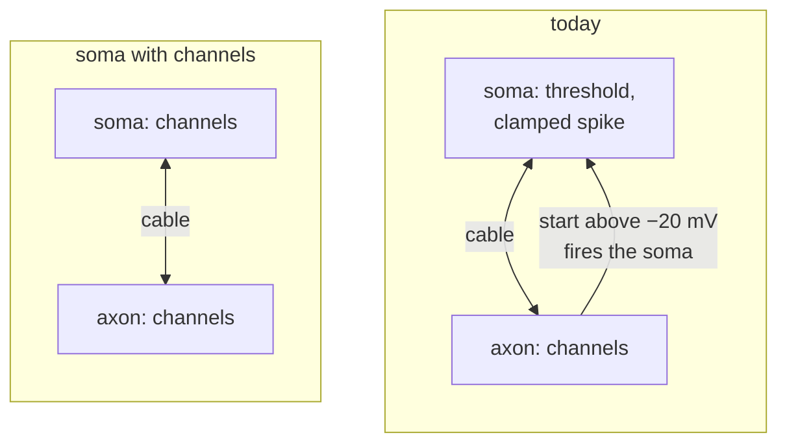

# Possible changes to Neuronify's architecture

Changes under consideration, with what each would take and what is still open.
`current.md` describes the code as it is.
A change leaves this file once it is decided against, or done and described there.

## Treat the soma as a compartment

The compartment engine did most of this.
The soma is one more point of its cell's tree,
current flows both ways between it and its dendrites and axon,
and axon endings are conductance synapses on a dendrite or a soma.
What is left is that the soma still spikes by a rule rather than through channels:

With channels, the spike would come out of the membrane,
and the axon would drive the soma through the cable like any other neighbour,
instead of firing it by rule.

What is still open:

- Channels: which ones the soma gets.
  The squid channels probably can't fire as slowly as today's soma,
  which many examples may depend on, though I haven't measured it in this engine.
  Adaptation and burst currents already exist as mechanisms on the soma point.
- Spike detection: synapses, meters, loudspeakers and the firing-rate halos
  read a neuron's spikes, which could be the voltage crossing a threshold upwards,
  as axon terminals already do at −20 mV.
- Neuronify 1 files: they set a threshold, reset and refractory period
  that channels don't have,
  so they would need a mapping or a kept integrate-and-fire soma.
- Physics and editing: somas have no `SpatialDynamics`,
  and `editor/drag.rs` and the dendrite taper (from the nearest soma)
  assume a separate soma.
- Save files: a new version with an upgrade.

The first step I would try is a headless test
comparing firing rate against input current for today's soma and a soma with channels,
in both preparations, without touching the editor or rendering.

## Untangle `update`

`Neuronify::update` mixes input timing, file loading, autosave, holds and their rings,
stepping, sound, landing previews, camera framing, the loupe and rendering
(see the list under "A frame" in `current.md`).
Not investigated yet.
